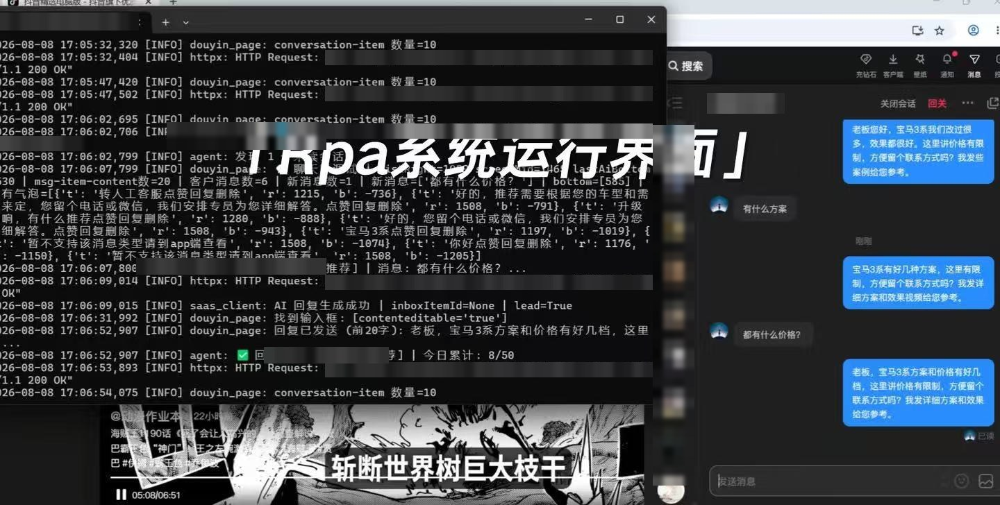
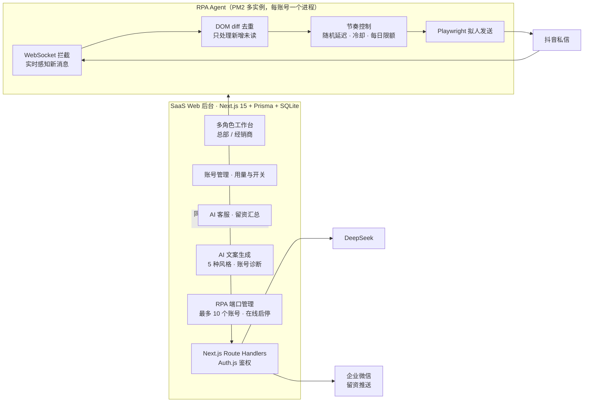
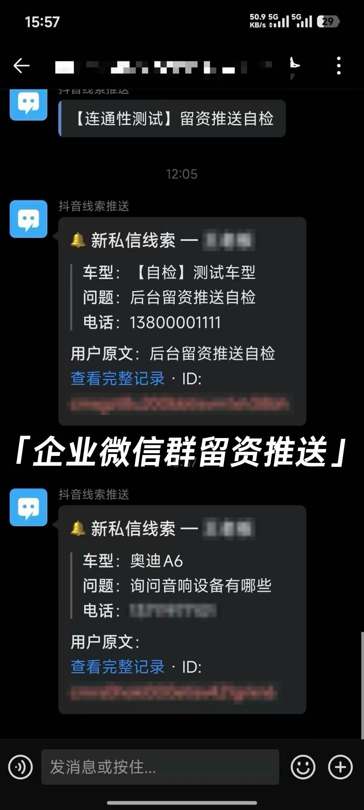
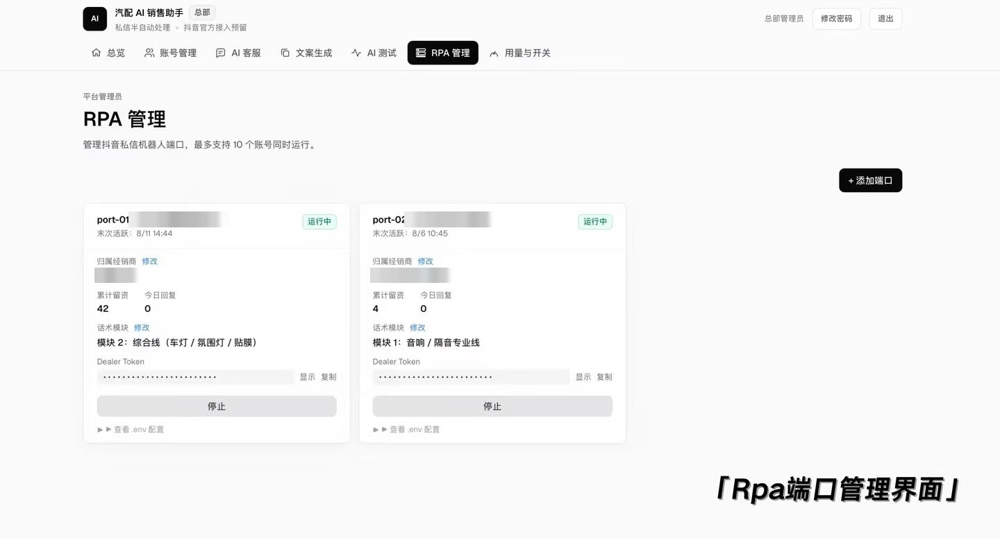
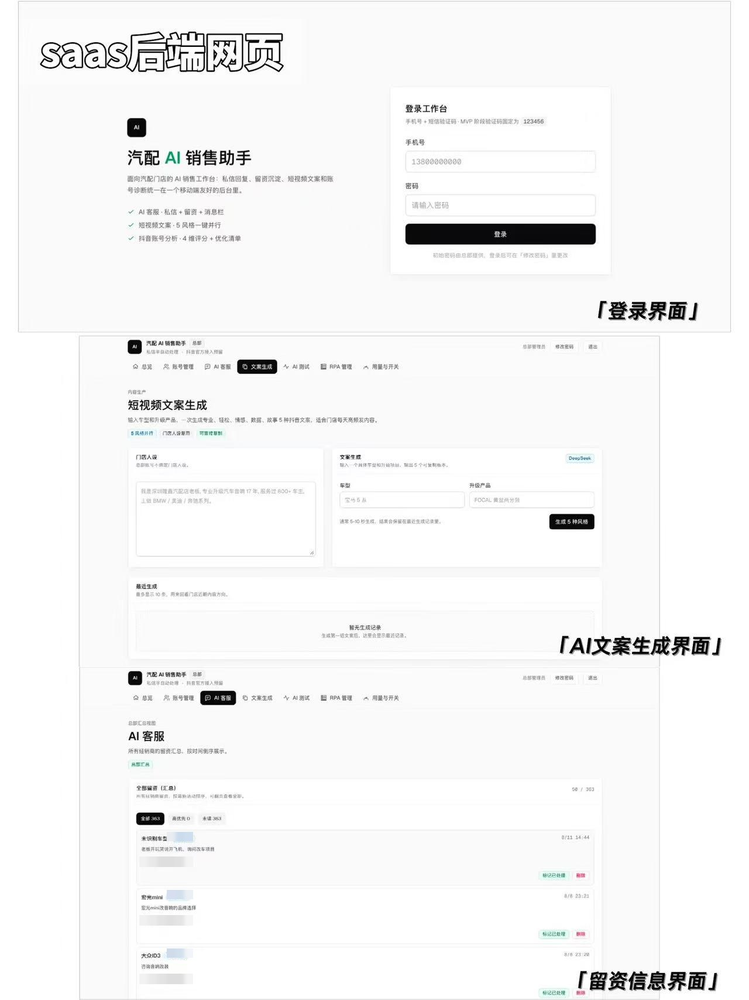

# 汽配 AI 销售助手 · SaaS 后台 + 抖音私信 AI Agent

> **A SaaS for auto-parts dealers: a multi-role web console plus an unattended AI agent that answers Douyin DMs** — 5 merchant accounts, ~200 auto-replies per day, 360+ leads captured, running in production.
>
> ⚠️ 本仓库为作品展示，客户项目源码不公开。截图已脱敏。

## 项目概览

| | |
| --- | --- |
| **客户** | 为汽配经销商提供抖音运营服务的 SaaS 公司 |
| **需求** | 总部和经销商统一管理门店抖音账号；7×24 自动处理私信咨询、沉淀留资并推给销售；批量生成短视频文案 |
| **我的角色** | 独立开发整套系统（Web 后台 + RPA Agent）：需求对接、方案设计、开发、测试、部署、交付 |
| **规模** | 5 个门店账号同时运行，日均自动回复约 200 条，累计沉淀留资 360+ 条 |
| **时间** | 2026.07 – 2026.08（从零学习到交付约 3 个月） |
| **后台技术栈** | Next.js 15 (App Router) · TypeScript · Tailwind CSS · Prisma + SQLite · Auth.js (NextAuth v5) |
| **Agent 技术栈** | Python 3 · Playwright (Chromium) · PM2 多实例（每端口一个进程） |
| **AI** | DeepSeek API（OpenAI 兼容 SDK） |
| **部署** | 阿里云 ECS · Nginx 反向代理 · PM2 |

## 架构

## 关键设计

### 0. SaaS 后台（Next.js 全栈单体）
一个 Next.js 15 App Router + TypeScript 的全栈单体应用：页面和 API 在同一个工程里，Prisma ORM 管理 SQLite 数据，Auth.js 负责登录鉴权，通过 OpenAI 兼容 SDK 调用 DeepSeek；部署在阿里云 ECS，Nginx 反代，PM2 守护进程。

总部和经销商分角色登录。功能包括：账号管理、AI 客服留资汇总、AI 测试、用量与开关；DeepSeek 驱动的短视频文案生成（输入车型和升级产品，一次出专业 / 轻松 / 情感 / 数据 / 故事 5 种风格，可设门店人设）和抖音账号诊断（4 维评分 + 优化清单）；RPA 端口管理，每个端口绑定经销商、话术模块和 Dealer Token，可在线启停。

### 1. 多账号隔离 + 登录态持久化
每个账号独立端口、独立 `browser-profile/` 用户数据目录，PM2 多实例运行，互不干扰。Chromium 用户数据持久化保存，进程重启后**免扫码**直接复用登录态。

### 2. WebSocket 实时感知新消息
不轮询刷新页面，而是监听抖音 IM 的 WebSocket 推送通道，有新消息即触发处理，无需反复刷新页面，响应及时。

### 3. DOM diff 去重
对会话列表计算签名，只处理**新增的未读会话**，避免对同一条消息重复回复。

### 4. 行为级反检测（不依赖 stealth 插件）
| 手段 | 配置项 |
| --- | --- |
| 拟人操作节奏 | `slow_mo` |
| 随机回复延迟 | `REPLY_DELAY_MIN` / `REPLY_DELAY_MAX` |
| 同一用户冷却 | `SAME_USER_COOLDOWN_SEC` |
| 每日回复上限 | `DAILY_REPLY_LIMIT` |

所有参数可配置，按账号风控情况随时调整。

### 5. 无人值守
- PM2 `autorestart`，进程崩溃 **5 秒内自动拉起**
- 每个实例独立 `agent.log` + `agent.error.log`，问题可追溯
- 遇到验证码等异常转人工处理，不硬闯

### 6. AI 回复 + 线索流转
Agent 把私信提交给后台，由后台调用 DeepSeek 按会话上下文生成自然回复（非固定模板）；识别出的车型、问题、电话写入留资库，并推送到企业微信，24 小时内去重。

## 成果

- ✅ 5 个门店账号稳定无人值守运行
- ✅ 日均自动回复约 200 条私信
- ✅ 累计沉淀留资 360+ 条
- ✅ 已交付客户上线使用

## 截图

> 客户名称、手机号、接口域名、用户昵称均已打码。

**企业微信线索推送**：私信里识别出车型、问题、电话后，自动推到门店企业微信群

**RPA 端口管理**：每个端口对应一个门店账号，可单独启停，按经销商配置话术模块

**SaaS 后台**：登录、AI 文案生成、留资汇总

---

作者：薛李锐 (Leo) · lxue5947@gmail.com · [GitHub 主页](https://github.com/lxue5947-sudo)
